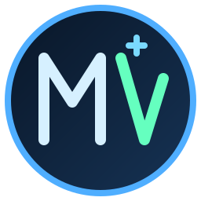

<p align="center">
  
</p>

<h1 align="center">MedViz Web Editor</h1>

<p align="center">
  Web-based 3D medical mesh viewer and light clinical editor for fast clinical review.
</p>

## Demo Video
<p align="center">
  <a href="https://youtu.be/Y-ifUgS4R30" target="_blank" rel="noopener noreferrer">
    
  </a>
</p>

<p align="center">
  <a href="https://youtu.be/Y-ifUgS4R30">Watch MedViz Demo on YouTube</a>
</p>

## Export Report Demo
<p align="center">
  <a href="https://youtu.be/rCmx7AW-bBw" target="_blank" rel="noopener noreferrer">
    
  </a>
</p>

<p align="center">
  <a href="https://youtu.be/rCmx7AW-bBw">Watch Export Report Demo on YouTube</a>
</p>

## Quick start (no Supabase required)

Use **Node.js 20+** and a current version of npm.

```bash
npm ci
npm run dev
```

Open **http://localhost:5173/** and choose **Free Demo**, or go directly to **http://localhost:5173/demo?local=1**. A synthetic sample STL mesh is loaded automatically, so you can inspect, measure, annotate, slice, export, and import your own STL/OBJ/PLY models without any account, database, or environment variables.

The local demo is **not a clinical case**: its bundled mesh is synthetic. It doesn't save cases to Supabase, share links, or provide cloud team comments. Imported files are handled in your browser, not uploaded to MedViz's hosted project.

### Optional: cloud accounts and shared cases

If you want to develop against your **own Supabase project**, create your local configuration file:

```bash
cp .env.example .env.local
```

On Windows Command Prompt you can use `copy .env.example .env.local` instead.

In `.env.local`, set:

```dotenv
VITE_SUPABASE_URL=https://your-project-id.supabase.co
VITE_SUPABASE_ANON_KEY=your-public-anon-or-publishable-key
```

Create/configure the database tables, storage buckets, and row-level-security policies required by cloud features in your own Supabase project. **Do not use the production MedViz credentials.** Never use Supabase service-role or other secret keys in any `VITE_` variable: Vite embeds these values in browser code. Restart `npm run dev` after changing the environment file.

When Supabase is not configured, the landing page and local demo remain usable, and cloud-only routes show clear setup instructions rather than a blank screen. Even with Supabase configured, **/demo?local=1** always uses the self-contained demo, while **/demo** uses the hosted shared-case experience.

### Checks

```bash
npm run typecheck
npm run build
```

If you see a Vite React Babel deprecation warning, it is independent of the missing Supabase configuration and should not prevent the local demo from starting.

## Tech Stack
- React (Vite)
- JavaScript (ES Modules)
- Three.js (WebGL rendering)
- HTML/CSS (custom clinic-focused UI)
- Node.js + npm (development/build tooling)

## Screenshots
- Folder: [`screenshots/`](./screenshots/)
- This folder contains UI and viewport captures for the project.
- More screenshots will be added here as development continues.

## Implemented Scope (v1 progress)
- STL/OBJ/PLY import with metadata extraction (name, format, triangles, vertices, file size, bbox)
- 3D navigation: orbit, pan, zoom, reset camera view
- Clinical slicing workflow: axis + plane position + clipping + apply cut/reset
- Measurement tool: click two surface points, label in mm, clear measurements
- Annotation tool: place markers, rename/delete markers, export markers JSON
- Transform tool: move/rotate/scale imported mesh + reset transform
- Rendering controls: grid, axes, center marker, shadow toggle (default off), wireframe, normal shading
- Export actions: STL/OBJ (validated against empty geometry), viewport PNG, HTML report
- Screenshot export option: include/exclude measurements and markers
- Undo/redo for trim/cut edits (buttons + keyboard shortcuts)
- Performance safeguards: indexed geometry optimization, heavy-model warnings, auto-simplify fallback, hard import limit
- Toast notifications for import/export errors and runtime feedback

## Source Layout
- `src/Medical3DCanvas.jsx`: core orchestration/state + scene lifecycle
- `src/medviz/constants/*`: themes and scene labels
- `src/medviz/controls/*`: custom orbit and transform controls
- `src/medviz/io/*`: model import/export and report helpers
- `src/medviz/scene/*`: generated scene presets
- `src/medviz/ui/*`: top bar, tool panels, model info, status bar, toast stack
- `src/medviz/utils/*`: reusable scene/UI helpers (e.g., text sprites)

## Notes
- Production build currently succeeds with Vite.
- Bundle-size warning is expected because Three.js is loaded in main chunk.

## License

MedViz Web Editor's original source code is **source-available** under the [PolyForm Noncommercial License 1.0.0](./LICENSE) (SPDX: `PolyForm-Noncommercial-1.0.0`). It is **not an OSI-approved open-source license**, because the license limits permitted use to noncommercial purposes.

You may inspect, use, modify, and redistribute the code for purposes permitted by the license, including personal learning, research, testing, and qualifying educational use. **Commercial use requires separate permission from the copyright holder.** If you want commercial licensing, contact the project owner through [MedViz 3D](https://medviz3d.com).

**Free demo vs. optional paid services:** The [MedViz 3D demo](https://medviz3d.com/demo) is free to try. Optional paid Pilot Sprint, Clinic Rollout, and custom workflow services cover guided setup, onboarding, hosting, support, and customization. Free access to the hosted demo does not itself grant commercial source-code rights.

**Prior versions and third-party components:** This change does not revoke rights validly granted under earlier releases or licenses (including ISC and AGPL-3.0). Third-party dependencies and assets continue under their respective terms. Only code for which the project owner has adequate licensing rights can be offered under these terms.
